# Awesome 3D Generative AI & Spatial Modeling 🌐✨

 

  

### 🚀 Curated Index of 3D Generative AI Platforms, Open-Source Foundation Models, and Spatial World Generation

*A directory covering Text-to-3D, Image-to-3D Diffusion, 3D Gaussian Splatting (3DGS), Neural Radiance Fields (NeRF), 3D-as-Code for LLMs, and Local Mesh Synthesis.*

**Last updated: November 2026**

---

## 📖 Overview

The **Awesome 3D Generative AI & Spatial Modeling** repository tracks leading **SaaS platforms** and high-impact **open-source GitHub projects** reshaping computer graphics, game development, VFX, CAD, robotics, and immersive XR experiences. 

These state-of-the-art tools synthesize production-grade textured 3D meshes (`.glb`, `.obj`, `.fbx`, `.usdz`), PBR material maps, UV layouts, quad retopology, and interactive 3D spatial worlds directly from natural language prompts, reference imagery, or LLM-authored code.

---

## 📑 Table of Contents

- [📊 Sector Overview & Market Dynamics](#-sector-overview--market-dynamics)
- [🏢 SaaS & Hosted Commercial Platforms](#-saas--hosted-commercial-platforms)
- [🔓 Open-Source GitHub Foundation Models & Frameworks](#-open-source-github-foundation-models--frameworks)
  - [⭐ Ranked Open-Source Repositories (By GitHub_Stars)](#-ranked-open-source-repositories-by-github-stars)
  - [🧩 ComfyUI, Add-ons & Developer Frameworks](#-comfyui-add-ons--developer-frameworks)
- [📈 Star History](#-star-history)
- [🤝 How to Contribute](#-how-to-contribute)
- [💖 Support](#-support)
- [⚖️ Disclaimer & Licenses](#-disclaimer--licenses)

---

## 📊 Sector Overview & Market Dynamics

The global **3D Generative AI and spatial content generation market** is currently estimated between **$2.5 billion and $3.2 billion**, accelerating at an aggressive compound annual growth rate (CAGR) of **~30.6%–30.9%** and projected to exceed **$9.4 billion by 2030**. 

The sector currently exhibits a **highly fragmented and rapidly evolving competitive landscape** at the application and vertical tool layer—characterized by fast-moving venture-backed startups and open-source models specializing in text-to-3D, image-to-3D, and parametric generation—bounded by an **oligopolistic infrastructure layer** where hyperscalers and dominant graphics conglomerates (such as Microsoft, Google, NVIDIA, and Autodesk) control compute supply, foundational architectures, and enterprise design pipelines.

---

## 🏢 SaaS & Hosted Commercial Platforms

Below is a comparison of leading 3D Generative AI SaaS and hosted commercial platforms, ranked by **estimated company size (valuation / funding / ARR)** in descending order.

| Rank | Platform | Valuation / Company Scale | Starting Paid Price | Free Tier / Trial Limit | Key Capabilities & Highlights |
| :---: | :--- | :--- | :--- | :--- | :--- |
| 1 | **[Luma AI (Genie)](https://lumalabs.ai)** | **$4.0B+ Valuation** ($1.0B+ raised, ~$80M ARR) | **$30.00 / month** (*Plus Plan* billed monthly; $25/mo billed annually) | **Freemium Evaluation Trial** (~30 trial credits on signup, non-commercial use, watermarked outputs) | High-speed text-to-3D, image-to-3D, and video-to-3D foundation models (`Genie` & `Dream Machine`) delivering quad-retopologized meshes and multi-format downloads (`GLB`, `FBX`, `OBJ`, `USDZ`). |
| 2 | **[Meshy.ai](https://www.meshy.ai/)** | **$1.5B Valuation** ($400M Series B, ~$100M ARR) | **$20.00 / month** (*Pro Plan* billed monthly; $16/mo billed annually) | **100 Free Credits / month** (non-commercial, CC-BY 4.0; max 10 untextured Meshy Lite downloads/month) | Comprehensive cloud generative 3D suite with text-to-3D, image-to-3D, AI PBR texture baking, automated remeshing, and native Blender, Unity, and Unreal Engine plugins. |
| 3 | **[Tripo 3D](https://tripo3d.ai)** | **$1.0B+ Valuation** ($446M Series B/B+, unicorn status) | **$20.00 / month** (*Pro Plan* billed monthly; ~$13.30/mo billed annually) | **200 Free Credits / month** (~13 basic generations/month, non-commercial public gallery, max 15 downloads) | High-throughput generative 3D platform producing production meshes with complete PBR material maps, multi-view reconstruction, segmentation, and Smart Mesh topology. |
| 4 | **[Hyper3D Rodin (Deemos)](https://hyper3d.ai)** | **~$100M+ Scale** (Series A hundreds of millions RMB, backed by ByteDance) | **$30.00 / month** (*Creator Plan* billed monthly; $23.33/mo billed annually) | **Free Exploration Plan** (Pay-by-result preview workflow, up to 10 private asset storage slots) | High-fidelity generative 3D modeling platform featuring multi-image geometry synthesis, OmniCraft mesh editing, and export-ready quad/triangle topology. |
| 5 | **[Spline AI](https://spline.design/ai-generate)** | **~$50M–$100M Valuation** ($32M funding raised, ~$5M ARR) | **$15.00 / month** (*Hobby Plan* billed monthly; $12/mo billed annually) | **Free Forever Plan** (Unlimited personal files, browser editor; outputs include Spline logo watermark) | Collaborative in-browser 3D design and scene synthesis editor combining generative AI prompt-to-3D, texture styling, and real-time WebGL interactive embeds. |
| 6 | **[Kaedim](https://kaedim3d.com)** | **~$60M Valuation** ($15M Series A backed by a16z, ~$5.6M ARR) | **$400.00 / month** (*Indie Plan* billed monthly) | **7-Day Discounted Trial** ($50 trial fee with 5 geometry generation credits before monthly renewal) | Enterprise production pipeline pairing deep learning with human-in-the-loop technical artist QA to deliver production-ready, UV-unwrapped game assets. |
| 7 | **[Common Sense Machines (CSM)](https://csm.ai)** | **Acquired by Google / DeepMind** (formerly VC-backed, ~$2.6M ARR) | **$20.00 / month** (*Maker Plan*, historical pre-acquisition tier) | **10 Free One-Time Credits** (*Tinkerer Tier*, CC-BY 4.0 public licensing) | Multimodal AI spatial modeling converting images, video, and text into interactive game assets and simulation-ready 3D worlds via Web Studio and API. |
| 8 | **[Sloyd.ai](https://www.sloyd.ai/)** | **~$15M–$25M Valuation** (€3M seed backed by Autodesk & a16z, ~$1.1M ARR) | **$15.00 / month** (*Plus Plan* billed monthly; $12.50/mo billed annually) | **1 AI 3D Generation / day** (*Guest Free Plan*, personal use, plus full parametric library access) | Parametric and generative 3D asset platform optimized for game developers needing instant, clean, low-poly UV-mapped props without manual retopology. |
| 9 | **[3DFY.ai](https://3dfy.ai)** | **Early-Stage Venture** ($1.5M Seed funding raised) | **$20.00 / month** (*Starter Plan*; or pay-as-you-go at $5.00 per model download) | **10 Free Welcome Credits** (One-time allowance upon user registration) | Automated high-quality 3D asset generation focused on structured object categories for e-commerce catalogs, virtual try-ons, and game development. |
| 10 | **[Masterpiece X](https://masterpiecex.com)** | **Early-Stage Venture** ($500K Seed funding raised, NVIDIA Inception partner) | **$10.99 / month** (*Creator Pack* 750 credits/mo; or $15.00 one-off pack) | **250 Free Starter Credits** (One-time sign-up credit grant for web & VR browser generation) | Browser and XR/VR text-to-3D generation playground allowing indie creators to generate, rig, animate, and remix textured 3D assets. |

---

## 🔓 Open-Source GitHub Foundation Models & Frameworks

Open-source 3D generative AI empowers game developers, spatial computing researchers, and 3D artists to run state-of-the-art inference locally on consumer or workstation GPUs (NVIDIA RTX 3080/4090/A100) with complete privacy, license ownership, and zero recurring credit paywalls.

### ⭐ Ranked Open-Source Repositories (By GitHub_Stars)

The following repositories represent the foundational algorithms, neural representations, and generative engines driving modern 3D AI, strictly sorted by **GitHub Stars_Count** in descending order:

1. **[graphdeco-inria/gaussian-splatting](https://github.com/graphdeco-inria/gaussian-splatting)**   
   The seminal reference implementation of *3D Gaussian Splatting for Real-Time Radiance Field Rendering* (SIGGRAPH 2023), enabling real-time rasterization and view synthesis of photorealistic 3D scenes.

2. **[NVlabs/instant-ngp](https://github.com/NVlabs/instant-ngp)**   
   NVIDIA's instant neural graphics primitives framework enabling real-time training and inference of Neural Radiance Fields (NeRF), signed distance functions (SDF), and gigapixel images in seconds.

3. **[Tencent-Hunyuan/Hunyuan3D-2](https://github.com/Tencent-Hunyuan/Hunyuan3D-2)**   
   High-resolution 3D asset generation suite utilizing large-scale flow-based shape diffusion (`Hunyuan3D-DiT`) and multi-view PBR texture synthesis (`Hunyuan3D-Paint`) with Gradio and Blender support.

4. **[microsoft/TRELLIS](https://github.com/microsoft/TRELLIS)**   
   Microsoft's state-of-the-art 3D generative foundation model (CVPR 2025 Spotlight) utilizing Structured 3D Latents (SLAT) to decode textured meshes, 3D Gaussians, and radiance fields from text or single images.

5. **[isl-org/Open3D](https://github.com/isl-org/Open3D)**   
   An open-source library that supports rapid development of software handling 3D point clouds, mesh processing, scene reconstruction, spatial alignment, and 3D visualization.

6. **[openai/shap-e](https://github.com/openai/shap-e)**   
   OpenAI's foundational 3D generative model capable of generating conditional 3D implicit functions, textured polygon meshes, and NeRF representations conditioned on text prompts or images.

7. **[nerfstudio-project/nerfstudio](https://github.com/nerfstudio-project/nerfstudio)**   
   A modular, collaboration-friendly framework for creating, training, and testing NeRFs and 3D Gaussian Splats with real-time visual web viewers and export pipelines.

8. **[facebookresearch/pytorch3d](https://github.com/facebookresearch/pytorch3d)**   
   Meta AI (FAIR)'s modular, efficient, and differentiable library of 3D deep learning operators, heterogeneous batching, ray-marching, and mesh renderers in PyTorch.

9. **[ashawkey/stable-dreamfusion](https://github.com/ashawkey/stable-dreamfusion)**   
   PyTorch implementation of Text-to-3D & Image-to-3D generation using 2D Stable Diffusion Score Distillation Sampling (SDS) with explicit textured mesh exportation.

10. **[VAST-AI-Research/TripoSR](https://github.com/VAST-AI-Research/TripoSR)**   
    Ultra-fast feed-forward 3D reconstruction model co-developed with Stability AI that generates textured 3D meshes from a single image in under 0.5 seconds on consumer GPUs.

11. **[threestudio-project/threestudio](https://github.com/threestudio-project/threestudio)**   
    A unified framework for 3D content generation from text prompts, single images, and few-view inputs using various diffusion distillation principles (`DreamFusion`, `Magic3D`, `Zero123`).

12. **[xxlong0/Wonder3D](https://github.com/xxlong0/Wonder3D)**   
    Cross-domain diffusion framework generating consistent multi-view normal maps and color images from a single RGB image to reconstruct detailed 3D textured geometry.

13. **[TencentARC/InstantMesh](https://github.com/TencentARC/InstantMesh)**   
    Feed-forward framework synthesizing high-quality 3D meshes from a single image in 10 seconds by integrating multi-view diffusion with a sparse-view Large Reconstruction Model (LRM).

14. **[cvg/Hierarchical-Localization](https://github.com/cvg/Hierarchical-Localization)**   
    The `hloc` visual localization and structure-from-motion (SfM) toolbox mapping images into persistent 3D spatial coordinate frames for robotics and spatial modeling.

15. **[hustvl/4DGaussians](https://github.com/hustvl/4DGaussians)**   
    4D Gaussian Splatting framework (CVPR 2024) delivering real-time dynamic spatial scene rendering and deformation tracking across temporal sequences.

16. **[MrForExample/ComfyUI-3D-Pack](https://github.com/MrForExample/ComfyUI-3D-Pack)**   
    An extensive node suite empowering ComfyUI to process 3D inputs, UV textures, 3DGS point clouds, and NeRF rendering via visual node-graph workflows.

17. **[Tencent-Hunyuan/HunyuanWorld-1.0](https://github.com/Tencent-Hunyuan/HunyuanWorld-1.0)**   
    Generative 3D spatial world modeling framework synthesizing explorable, interactive 360° environments and mesh landscapes from words or pixels.

18. **[wgsxm/PartCrafter](https://github.com/wgsxm/PartCrafter)**   
    Structured 3D mesh generation model (NeurIPS 2025) via compositional latent diffusion transformers, generating semantically decomposed, individually editable 3D parts.

19. **[NVlabs/nvdiffrec](https://github.com/NVlabs/nvdiffrec)**   
    NVIDIA's differentiable rendering pipeline (CVPR 2022 Oral) extracting triangular 3D models, PBR materials, and environment lighting directly from multi-view images.

20. **[Sandflow-ai/sand3d](https://github.com/Sandflow-ai/sand3d)**   
    Declarative Python 3D-as-code modeling library built over Blender's `bpy` specifically for LLMs, generating deterministic, articulated 3D assemblies exported to `GLB`, `URDF`, `USD`, and `STL`.

21. **[apple-aiml-research/ml-aim](https://github.com/apple-aiml-research/ml-aim)**   
    Apple's multimodal autoregressive visual foundation model pre-training code and checkpoints (AIMv1 and AIMv2) for high-capacity visual representation learning.

22. **[allenai/objaverse-xl](https://github.com/allenai/objaverse-xl)**   
    A massive universe of 10M+ 3D objects curated by the Allen Institute for AI (AI2), serving as the principal benchmark and pre-training dataset for 3D generative AI.

23. **[bytedance/1d-tokenizer](https://github.com/bytedance/1d-tokenizer)**   
    ByteDance's continuous 1D tokenizer and sequence generative model architecture for continuous multidimensional signals and geometry synthesis.

24. **[3DTopia/Phidias-Diffusion](https://github.com/3DTopia/Phidias-Diffusion)**   
    ICLR 2025 generative model for synthesizing 3D content from text, image, and 3D conditions with reference-augmented diffusion.

25. **[autonomousvision/occupancy_flow](https://github.com/autonomousvision/occupancy_flow)**   
    Continuous 4D reconstruction framework learning particle dynamics and time-varying 3D surface geometry from dynamic visual sequences.

---

### 🧩 ComfyUI, Add-ons & Developer Frameworks

- **[AIExxplorer/AIEXX_GENAI_IMAGE_TO_3D](https://github.com/AIExxplorer/AIEXX_GENAI_IMAGE_TO_3D)**: Ready-to-use ComfyUI node pipeline combining image preprocessing, multi-view generation, and local mesh extraction.
- **[blendrelay-mcp](https://github.com/blendrelay/blendrelay-mcp)**: Blender AI add-on and Model Context Protocol (MCP) server enabling AI coding agents (Claude Code, OpenAI Operator) to generate Geometry Nodes and 3D scenes via conversational directives.
- **[EYamanS/chisel](https://github.com/EYamanS/chisel)**: GPU-free, headless MCP server allowing AI agents to procedurally construct, CSG boolean-edit, and export `.glb`/`.obj` 3D models.
- **[PolyzonMaker](https://github.com/Polyzon/PolyzonMaker)**: Desktop application built with Tauri and Rust for converting photos and text prompts into 3D-printable `STL` and `3MF` files locally.

---

## 📈 Star History

---

## 🤝 How to Contribute

Contributions are warmly welcomed! Help keep this repository the most comprehensive and up-to-date resource for 3D generative AI and spatial modeling:

1. 🍴 **Fork** this repository.
2. 🌿 Create a new branch: `git checkout -b feature/add-new-tool`
3. 📝 Add your entry under either the SaaS table or the Open-Source section following the existing formatting conventions (ensure pricing, free tier limits, and accurate GitHub links are provided).
4. 🚀 Commit your changes: `git commit -m "Add New-3D-Tool to ecosystem"`
5. 📬 Submit a **Pull Request** with a concise description of the tool or framework.

---

## 💖 Support

If you find this ecosystem directory helpful for your research, creative projects, or technical pipelines, please consider supporting the project:

- ⭐ **Star** this repository to help others discover it.
- 🍴 **Fork** and share it with your network on Discord, X (Twitter), and LinkedIn.
- ☕ **Buy me a coffee**: Support ongoing curation, benchmarking, and updates on the [**GitHub Sponsors Dashboard**](https://github.com/sponsors/ishandutta2007).

---

## ⚖️ Disclaimer & Licenses

- This list is community-curated for informational and research purposes; inclusion does not imply official endorsement.
- Verify specific model weight and code licenses (`MIT`, `Apache-2.0`, `CC-BY-NC-4.0`, or custom research agreements) before integrating any model or generated asset into commercial gaming, film, or enterprise production.
- Local deep learning pipelines (such as Hunyuan3D-2, TRELLIS, and InstantMesh) generally require a dedicated NVIDIA GPU with 12GB to 24GB+ VRAM for optimal inference performance.

---

  Built with ❤️ for 3D artists, game developers, spatial AI researchers, and machine learning engineers.

